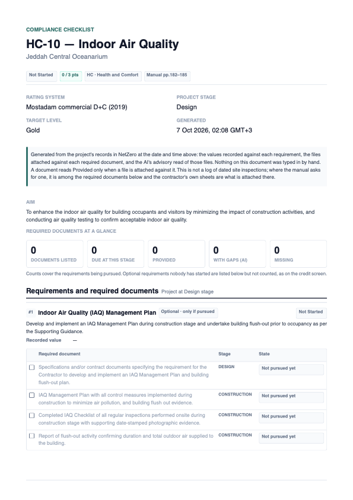
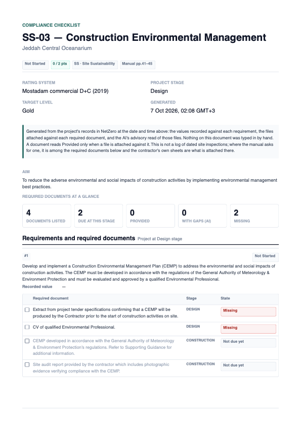

# 1 — IAQ / ESC compliance checklist, generated as a PDF

**Type:** Feature · **Verdict:** All inputs already exist; nothing new to enter · **Effort:** M

## As raised

> Search online for ESC and IAQ checklists. Let me know if we can make those.
>
> This is something that should get generated automatically from the existing
> status of the project. It's not something that the user would manually
> create. For the images, item answers and all that, we can just generate the
> report and then download it.

Green Badger (the LEED tool the client knows) has in-field IAQ and ESC
inspection checklists. The ask is the Mostadam equivalent, produced from what
the project already holds, downloaded as a document.

## What the manual asks for

Both checklists map to a Mostadam credit. Page numbers are the Commercial D+C
manual's own.

**IAQ → HC-10 Indoor Air Quality, requirement 1** (pp. 180–182). The
construction-stage evidence names the checklist outright:

> Completed IAQ Checklist of all regular inspections performed onsite during
> construction stage with supporting date-stamped photographic evidence.

The supporting guidance fixes the plan's six control-measure categories
(SMACNA plus Mostadam's own Moisture & Mold Control): HVAC Protection, Source
Control, Moisture & Mold Control, Pathway Interruption, Housekeeping,
Scheduling. It adds a flush-out (2 ACH after testing and balancing) and, for
requirement 2, the IAQ test limits of Table HC-10.1.

**ESC → SS-03 Construction Environmental Management, requirement 1**
(pp. 39–42). Mostadam has no erosion-and-sedimentation credit; the word
"erosion" appears once in the whole manual, as a soil bullet in SS-04. The
construction-stage evidence SS-03 wants is:

> Site audit report provided by the contractor which includes photographic
> evidence verifying compliance with the CEMP.

and the guidance lists the CEMP's seven sections (a–g): EIA, dust control,
noise monitoring, waste management, energy and water reduction, site audit
plan, materials transport and procurement. That is where ESC lives in
Mostadam. Building a LEED-style ESC form would go against the Mostadam-only
scope.

## What exists today

Everything the report needs is already stored and already shown on the credit
screen. Checked against the running parser on 2026-10-07:

| Input | Where it lives | HC-10 | SS-03 |
|---|---|---|---|
| Requirement text, status, value, note | `requirement_entry` + `catalog_requirement` | 2 rows | 2 rows |
| Required documents, tagged by stage | `catalog_requirement.evidence_specs` | 4 + 3 | 4 |
| Which documents are due at the project's stage | `docGates()` in `lib/evidence.ts` | derived | derived |
| Files per document (name, size, date, path on disk) | `evidence_doc.evidence_spec_index` | — | — |
| AI read of each file: verdict, summary, quotes, gaps | `evidence_review` | — | — |
| Credit-level additional attachments | `evidence_doc` with null requirement | — | — |
| The manual's plan contents (control measures, CEMP sections) | `catalog_credit.supporting_guidance` | 6 items | 7 sections |
| Project name, stage, target level, rating system | `project`, `rs_version` | — | — |

The supporting guidance is stored as one flattened string (the parser joins
the lines), but its list markers survive: `o HVAC Protection o Source Control
…` on HC-10 and `a) … • … o …` on SS-03. All 56 credits carry guidance.

There is also a working PDF path: `lib/pdf/CatalogReport.tsx` renders with
`@react-pdf/renderer` (built-in Helvetica, a `safe()` WinAnsi filter, a
hyphenation hook) through `app/api/catalog/[versionId]/pdf/route.ts`, and the
Excel scorecard shows the per-project download pattern
(`app/api/projects/[id]/export/route.ts`, `ExportScorecardLink`).

## Proposed change

One **Download compliance checklist (PDF)** button on every credit page. The
PDF is built from the credit's current state at the moment of download. No new
table, no migration, nothing for the user to fill in.

It is built for any credit, not just HC-10 and SS-03. The data model is
identical across all 56 credits, and a parser that only knows two credits is
the overfitting mistake already logged in `MISTAKES.md`. HC-10 is the IAQ
checklist and SS-03 is the ESC/CEMP checklist because of what their documents
and guidance say, not because the code names them.

### What the PDF contains

1. **Header.** Project, rating system and version, project stage, target
   level, credit code and title, credit status and points, manual page span,
   generation date and time. Marked clearly as generated from project records.
2. **Requirements.** One block per requirement in scope (set-aside either/or
   options named apart, as the Required documents box does): text, status,
   recorded value, note.
3. **Required documents checklist.** One row per listed document, with:
   - stage tag and whether it is due at the project's stage;
   - state: **Provided**, **Provided with gaps**, **Missing**, or **Not due
     yet**. Provided means a file is attached against that document. "With
     gaps" means the AI read returned `partially_met` or `not_met`;
   - the files: name, size, upload date;
   - the AI read, labelled advisory: verdict, one-line summary, listed gaps.
4. **Photographs.** Any attached file that is a PNG or JPEG is embedded, with
   its filename, upload date and the document it was attached to. That is the
   "date-stamped photographic evidence" HC-10 and SS-03 both ask for, drawn
   from uploads the contractor already made. Other formats (PDF, DOCX…) are
   listed, not embedded. A per-image size cap applies; a file over it is
   listed with a note.
5. **What the manual requires the plan to contain.** The itemised list pulled
   from the stored supporting guidance: the six control measures on HC-10, the
   seven CEMP sections on SS-03. Printed as a reference checklist for whoever
   reviews the uploaded plan. These rows are **not** ticked by the app: nothing
   in the data says whether the uploaded IAQ plan covers Housekeeping. If the
   guidance has no recognisable list, the section is omitted.
6. **Additional attachments** at credit level, listed.

### What it must never do

- Mark a document Provided without a file behind it.
- Let the AI verdict change a state on its own. It is printed next to the
  state, never used to compute it. This matches the rule already in
  `lib/ai/evidence-review.ts`.
- Claim to be a log of dated site inspections. The manual's own wording is
  "IAQ Checklist"; the PDF is titled **Compliance checklist** and its header
  says it was generated from project records on a given date. If an assessor
  wants the contractor's weekly sheets, those are what the contractor uploads
  against the "Completed IAQ Checklist" document, and this PDF then carries
  them.

### Commits, in order

Each is one commit on `feat/compliance-checklist-pdf`, with its tests, and
is checked in a browser before the next starts.

| # | Commit | Files | Tests |
|---|---|---|---|
| 1 | **Guidance items.** Split a stored supporting-guidance string into headed item lists, tolerant of the flattened form and of page-number noise (`182`, `41` mid-text). Returns `[]` when no list is found. | `lib/report/guidance-items.ts` | HC-10 → 6 control measures; SS-03 → 7 sections a–g with their bullets; a guidance string with no list → `[]`; a string with a stray page number does not produce a row |
| 2 | **Checklist model.** Pure function `CreditView + project + stage → ChecklistModel`: document rows with state, files, review; photos; guidance items; set-aside options. No I/O. | `lib/report/checklist.ts` | state per document for every combination of file / review verdict / due; set-aside options excluded; optional rows not counted; credit-level files listed separately; PNG/JPEG picked as photos, others not |
| 3 | **Shared PDF primitives.** Move `safe()`, the palette, base styles and `registerPdfHyphenation` out of `CatalogReport.tsx` into `lib/pdf/shared.ts`. Behaviour-preserving; the catalog PDF route is re-downloaded and compared. | `lib/pdf/shared.ts`, `lib/pdf/CatalogReport.tsx` | existing `catalog-export` tests stay green |
| 4 | **Checklist PDF.** `ChecklistReport.tsx` renders the model. Images read from `evidence_doc.file_path` by the route, passed in as buffers so the component stays pure and testable. | `lib/pdf/ChecklistReport.tsx` | renders to a buffer for a fixture model with every state present; a model with an unreadable image path still renders |
| 5 | **Route and button.** `GET /api/projects/[id]/credits/[code]/checklist`: auth, workspace-scoped (`getProject` → 404 for another workspace), Node runtime, `force-dynamic`, `Content-Disposition: attachment`, filename `<project>-<code>-checklist.pdf`. Button in the credit header next to Export/Targeted. | `app/api/projects/[id]/credits/[code]/checklist/route.ts`, credit `page.tsx` | route returns 401 unauthenticated, 404 for a foreign project, 200 `application/pdf` otherwise |
| 6 | **Done section + screenshots** appended here. | this file, `evidence/` | — |

Stretch, only if asked: a project-level **Compliance pack** on the Documents
page that concatenates every targeted credit's checklist. Same component, one
more route.

### Browser check before calling it done

On the Jeddah project, in Playwright:

1. HC-10 at design stage, nothing uploaded: download, open the PDF, every
   construction document reads Not due yet, the design document reads Missing,
   the six control measures are listed.
2. Upload a JPEG site photo against "Completed IAQ Checklist…" and a PDF
   against "IAQ Management Plan…", let the AI read finish, download again:
   the photo is embedded with its date, the plan is listed with the verdict.
3. Switch the project to Construction: the same documents now read Missing or
   Provided, never Not due yet.
4. SS-03: the seven CEMP sections appear; the site-audit document row carries
   its photo.
5. A credit with no list in its guidance renders without the guidance section
   and without error.
6. E-01 (either/or): the set-aside option is named, not listed.
7. The existing catalog PDF still downloads and looks the same after commit 3.
8. No console errors, no 5xx; `pnpm test`, `tsc --noEmit`, `pnpm lint`.

## Decisions for you

1. **Name.** "Compliance checklist" on the button and the PDF, not
   "inspection report". Say if you want the manual's phrase "IAQ Checklist"
   used on HC-10 specifically.
2. **Per-credit first.** The IAQ and ESC asks are two credits. A whole-project
   pack is a small follow-up once the per-credit PDF is approved.
3. **Guidance rows stay unticked.** Ticking "Housekeeping covered" would need an
   AI pass over the uploaded plan against the list. It can be added later as
   an advisory column, same rules as the existing AI read. Not in this item.
4. **Images.** Only PNG and JPEG embed; `@react-pdf/renderer` does not take
   WebP, GIF or PDF pages. Those are listed by name.

## Out of scope

- Any manual data entry: templates, inspections, item answers, signatures.
- A LEED-style ESC form. Erosion control enters through SS-03's CEMP.
- Changing how status or points are computed.
- Re-parsing the catalog. Guidance is read from the stored string at download
  time, so existing versions work without a migration.

---

## Done — 2026-10-07

Every credit page has a **Download checklist (PDF)** button in its header,
next to the status pill. It calls
`GET /api/projects/[id]/credits/[code]/checklist`, which builds the PDF from
the project's state at that moment. No new table, no migration, no manual
entry.

The four decisions above were taken as recommended: "Compliance checklist" on
the button and the PDF; per-credit only; the manual's plan-content rows are
printed as blank boxes with a note saying so; PNG and JPEG embed, other types
are listed.

### Commits on `feat/compliance-checklist-pdf`

| Commit | Change |
|---|---|
| `ef1f8c0` | Guidance items: itemised lists pulled from the stored supporting guidance (17 tests on the real HC-10, SS-03, E-01 and W-02 strings) |
| `6a66201` | Checklist model: documents, states, files, AI reads, photos, set-aside options, counts; `supportingGuidance` on `CreditView`; `STATUS_LABEL` shared with the Excel export |
| `ac27e32` | Shared PDF primitives pulled out of the catalog report — catalog PDF byte-identical before and after (548,955 bytes, 64 pages) |
| `ae451e9` | The checklist PDF component, rendered in a test and read back |
| `8b7fbb0` | Route and button, plus four fixes found only by downloading real PDFs (below) |
| this one | Done section, evidence |

### What the PDF looks like

[HC-10](./evidence/after-HC-10-iaq-checklist.pdf) ·
[SS-03](./evidence/after-SS-03-cemp-checklist.pdf) ·
[W-02](./evidence/after-W-02-files-ai-reads-unreadable-images.pdf) ·
[PMM-03](./evidence/after-PMM-03-provided-and-missing.pdf) ·
[E-01, path chosen](./evidence/after-E-01-path-chosen.pdf) ·
[E-01, no path chosen](./evidence/after-E-01-no-path-chosen.pdf) ·
[HC-10 with a photograph](./evidence/after-HC-10-photo-embedded.pdf)

1. **Header**: credit, project, status chip, points as the screen shows them
   ("4 / 2–10 pts" on W-02), keystone, category, manual pages; rating system
   worded exactly as the Excel export words it; stage, target level,
   generation time in Riyadh time.
2. **Provenance note**: generated from project records, nothing typed in, a
   document reads Provided only with a file against it, not a log of dated
   site inspections.
3. **Summary tiles**: documents listed, due at this stage, provided, with
   gaps (AI), missing. When optional untouched rows exist, a line says the
   counts cover pursued requirements only, as on the credit screen.
4. **One ruled section per requirement**: number, title, path/optional tag
   with the screen's wording ("Pursuing this path", "Optional · only if
   pursued", "Optional · pursuing"), status, text, recorded value, note; then
   a table with a tick box, the document, its stage and its state — Provided,
   Provided — AI read found gaps, Missing, Not due yet, Not pursued yet — with
   each attached file (name, size, upload date) and its AI read labelled
   "advisory only" with the screen's verdict wording and the listed gaps.
   Files attached without a document slot are listed under "Other files".
5. **Either/or**: an open group prints as one "no path chosen yet" box naming
   the options; a chosen path is listed and the set-aside option is named
   under "Not listed".
6. **Additional attachments** at credit level, listed with their AI read.
7. **Photographs**: every PNG/JPEG, embedded, with upload date and what it was
   attached against. An unreadable one prints "[image could not be read]".
8. **What the manual requires the plan to contain**: blank boxes. HC-10 gives
   the six SMACNA control measures and the IAQ testing rules; SS-03 the seven
   CEMP sections with every bullet nested under them, then the Environmental
   Professional criteria. 49 of the 56 credits have at least one list.

### Found only by downloading, and fixed

- **Photos drew nothing.** The two `Site-Photo-Accommodation.png` uploads in
  the dev database are 4 KB of random bytes, not PNGs, and react-pdf draws
  nothing for bytes it cannot decode, silently. The route now sniffs the
  bytes (PNG/JPEG magic, not the file name) and anything else is listed as
  unreadable. Confirmed with a generated 320×200 PNG attached to the Riyadh
  test project's "Completed IAQ Checklist" slot: it embeds (one image object
  in the PDF, visible on page 3). That test row and file were removed again.
- **Untouched optional rows shouted "Missing".** HC-10's two requirements
  are both optional, so the screen lists their documents but counts nothing.
  The PDF said 0 listed while painting every row red. Those rows now read
  "Not pursued yet", in grey, and the tiles carry the note.
- **Tiles overlapped.** react-pdf inherits the page's computed line height,
  so 16pt digits got a 12.6pt line. Larger text now sets its own.
- **A block could start as a bare border at a page foot.** react-pdf splits
  a wrapping view wherever the page ends; `minPresenceAhead` only keeps
  *following* content with a child, so it moved whole blocks instead. Blocks
  are now ruled sections whose header is unbreakable, so a block splits at a
  document row or not at all.
- "Not due yet" was printed twice per row.

### Checks

Without Playwright, as asked. The dev server ran against `netzero_v2`; the
route was called with `curl` and a session cookie minted the way
`lib/auth/session.ts` mints one.

| Check | Result |
|---|---|
| No cookie | 401 |
| Project id from nowhere | 404 |
| Unknown credit code | 404 |
| HC-10, SS-03, W-02, PMM-03, E-01 on Jeddah; E-01, HC-10 on Riyadh | 200, `application/pdf`, `attachment; filename="jeddah-central-oceanarium-hc-10-checklist.pdf"` |
| Credit page HTML carries the button with the right href | pass |
| Design stage: construction documents Not due yet, design documents Missing (SS-03, PMM-03, E-01) | pass |
| A file against a document reads Provided with its AI read (PMM-03 "Appears to meet"; W-02 "Could not read") | pass |
| Credit-level file listed with "Partially meets" and its four gaps (PMM-03) | pass |
| Set-aside option named, not listed (Jeddah E-01); open group as one choose box (Riyadh E-01) | pass |
| Untouched optional rows Not pursued yet, counted 0 (HC-10, W-02 #5) | pass |
| A started optional row counted and Completed (W-02 #4) | pass |
| Six control measures and seven CEMP sections printed as blank boxes | pass |
| Real PNG embedded; junk "PNG" reads unreadable | pass |
| ≤ in text renders as `<=`; `µ` kept; E-01's equations, set by the manual in mathematical-italic letters, fold to plain text ("R - value (m2K W/ ) = Material Thickness (m) …"), no `?` anywhere in the PDF | pass, after Hadi's review (below) |
| Catalog review PDF byte-identical after the shared-primitives refactor | pass |
| `pnpm test` | 162 passing, 9 skipped (database tests off) |
| `tsc --noEmit` | clean |
| `pnpm lint` | 0 errors, the 5 pre-existing warnings |
| `pnpm build` | succeeds |

### Left as found, worth knowing

- Two stored requirement texts carry parser noise the PDF reproduces
  faithfully: W-02 #3 begins "3 The irrigation…" and ends "2 Landscaping";
  PMM-03 #1 is cut at "requirements in the". Catalog data, not this feature.
- E-01's stored guidance has "generally 101 accepted" (a page number inside
  a sentence). The page-number rule only strips a number after a sentence
  end, a colon or a marker, on purpose, so "equals 2 Air Changes" survives.

### Hadi's review — question marks in E-01

Hadi opened the E-01 PDF and found strings of `?` where the manual's R-value
and U-value equations should be. The manual sets those in Unicode
mathematical-italic letters, which Helvetica cannot encode, and `safe()`
wrote `?` for each. I had seen it and filed it as "stored text"; that was
wrong, and is logged in `MISTAKES.md`.

Fixed in `lib/pdf/shared.tsx`, so the catalog review PDF benefits too: a
character Helvetica cannot set is first folded with Unicode compatibility
normalisation (𝑅 → R, ℎ → h), and the equation symbols `−`, `⁄` and `∑` are
mapped by hand. A glyph that still cannot be set stays `?`, by design. The
re-downloaded E-01 has no `?` in it (`tests/pdf-safe.test.ts` checks the
whole stored E-01 guidance for that).
- Postgres.app has a per-app permission dialog for trust connections. A dev
  server started with a shell `&` got every query rejected; started through
  the harness it worked. Noted for the next session.
