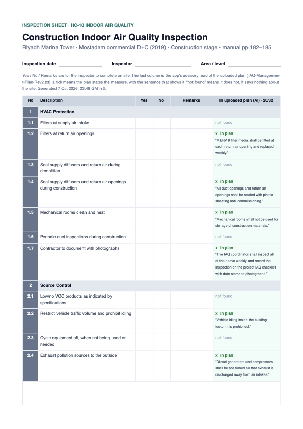

# 2 — IAQ inspection sheet, in the site team's own format

**Type:** Feature · **Verdict:** Form structure and photos derive from project data; the ticks are a human's · **Effort:** M

## As raised

Hadi shared three pages of the contractor's current form for the Jeddah
Oceanarium: a numbered table (1 HVAC Protection 1.1–1.7, 2 Source Control
2.1–2.8, 3 Pathway Interruption 3.1–3.5, 4 Housekeeping 4.1–4.6, 5 Scheduling
5.1–5.2) with **Yes / No / Remarks** columns and N/A remarks; a confirmation
statement with a signature and date; and a two-column **Description | Photos**
table.

> Can we have something like this? The 3rd image is basically the format in
> which they attach images.

## What was settled

Asked where the Yes/No answers should come from, Hadi asked whether the AI
could fill them reliably. It cannot, and I said so: the items are statements
about site conditions on a date, the AI's only inputs are the uploaded plan
(intentions, not practice) and photos the current text-only model cannot read,
and a machine guess under a signature line is what an assessor rejects. Hadi
took the recommended hybrid:

- the sheet is generated in the team's layout with **Yes / No / Remarks left
  blank**, to tick and sign as they do now, then upload as the "Completed IAQ
  Checklist" evidence;
- one extra **advisory** column, *In uploaded plan (AI)*: a tick with the
  sentence from the uploaded IAQ Management Plan that addresses the item, or
  "not found". Never in the Yes/No cells;
- photos table: **file name + the document it was attached under + date**, no
  caption field;
- a sixth section, **Moisture & Mold Control**, because Mostadam HC-10
  requires it in addition to SMACNA's five and the team's form lacks it.

## Proposed change

A **Download inspection sheet (PDF)** button beside *Download checklist (PDF)*
on credits that have a sheet template. One template ships: the IAQ sheet,
matched to a credit whose title is "Indoor Air Quality" (by title, not code,
since codes differ across Mostadam schemes). The CEMP site-audit sheet for
SS-03 follows the same mechanism once the team shares the form they use.

The PDF:

1. Header: project, credit, rating system, stage, generation time; blank
   **Inspection date** and **Inspector** lines.
2. The table: No · Description · Yes · No · Remarks · *In uploaded plan (AI)*.
   The last column shows ✓ + quote, "not found", or "not run" with the reason
   (no plan uploaded, plan unreadable, no model configured, model timed out).
3. The confirmation statement, a signature line and a date line.
4. **Description | Photos**: every PNG/JPEG attached to the credit, one per
   row, with file name, the required document it was attached under (or
   "other file" / "additional attachment") and the upload date.

### The advisory column

`lib/ai/plan-coverage.ts`. The plan text is the readable text of the files
attached against the credit's "IAQ Management Plan" document (and, failing
that, any readable file on the credit). One JSON call lists each item and asks
for `{no, covered, quote}`; a quote is kept only if it is a verbatim substring
of the plan text (the house rule from the evidence review), and an item with
no verifiable quote reads "not found". Runs at download time with a 25 s
budget; past that the column says "not run — model timed out" and the sheet
still downloads. Nothing is stored.

### Commits

| # | Commit | Tests |
|---|---|---|
| 1 | Template (the team's items + section 6) and the pure sheet model: sections, photos, header; coverage slotted in per item | template matches by title, not code; 32 items numbered as the team numbers them; photos carry slot text and date |
| 2 | Plan coverage: prompt, normalisation, quote verification, text gathering, timeout | fabricated quotes dropped; missing items read not found; no plan → not run with reason |
| 3 | `InspectionSheet.tsx` and render test | renders with coverage, without coverage, with and without photos |
| 4 | Route + button + Done section + evidence | 401 / 404 / 200; real downloads read page by page |

## Out of scope

- Storing ticks, remarks or signatures in the app.
- Reading photographs with a vision model.
- A CEMP (SS-03) template, until the team's form is available.

---

## Done — 2026-10-07

A **Download inspection sheet (PDF)** button sits beside *Download checklist
(PDF)* on HC-10 (and on any credit titled Indoor Air Quality in another
scheme). It calls `GET /api/projects/[id]/credits/[code]/inspection-sheet`.
Credits without a template get no button and a 404 from the route.

### Commits

| Commit | Change |
|---|---|
| `7c0a12c` | Template (the team's 28 items + Moisture & Mold Control, 32 in all), the sheet model, the advisory plan read with verbatim-quote verification; `creditPhotos` shared with the checklist |
| `83c0840` | The sheet PDF: the team's table, blank Yes/No/Remarks, the advisory column, confirmation and signature block, Description \| Photos table |
| this one | Route, button, this section, evidence |

### What it looks like

[Jeddah HC-10, no plan uploaded yet](./evidence/after-sheet-HC-10-no-plan.pdf) ·
[Riyadh HC-10 with a plan and a photograph](./evidence/after-sheet-HC-10-plan-read-and-photo.pdf)

- **Header**: sheet title, project, rating system, stage, manual pages; blank
  *Inspection date*, *Inspector*, *Area / level* lines.
- **The table**, as the team draws it: dark numbered column, section rows (1
  HVAC Protection … 6 Moisture & Mold Control), Yes / No / Remarks empty, and
  a sixth column **In uploaded plan (AI) · 19/32** showing a tick plus the
  plan's own sentence, or "not found". A note above the table says what the
  column is and that it says nothing about the site. When the read did not
  run the column reads "—" and the note gives the reason ("not run — no plan
  uploaded yet").
- **Confirmation and signature**: the team's declaration, reworded only to
  name the IAQ Management Plan, with Signature and Date lines.
- **Photographs**: on its own page, Description | Photos, one row per image
  with file name, where it was attached and the upload date. With no images,
  a one-line note instead and no extra page.

### The advisory read, on a real plan

To exercise the column end to end, a short IAQ Management Plan (text) and a
PNG were attached to the Riyadh test project's HC-10 for one download and
removed again. The read took 13 s and marked 19 of 32 items covered. Every
quote is a verbatim sentence of the plan — the code drops any that is not.
Reading the quotes shows the column's limits honestly: 1.7, 2.8, 3.5, 4.6 and
6.4 ("document with photographs") all point at the same coordinator sentence,
and 4.1 ("regular cleaning, including HVAC equipment") is matched to the
floor-sweeping sentence, which covers half the item. That is why the quote is
printed and the Yes/No cells stay empty: a reviewer decides, with the
evidence in front of them.

### Checks

Without Playwright, via `curl` with a minted session cookie against the dev
server and `netzero_v2`, each PDF opened and read page by page.

| Check | Result |
|---|---|
| No cookie | 401 |
| SS-03 (no template) | 404 "No inspection sheet for this credit" |
| Jeddah HC-10 | 200, `attachment; filename="jeddah-central-oceanarium-hc-10-iaq-inspection.pdf"` |
| Button present on HC-10's page, absent on SS-03's | pass |
| No plan uploaded: column "—", header "not run", note gives the reason | pass |
| Plan uploaded: 19/32 covered, every quote verbatim, "not found" elsewhere | pass |
| Photo embedded in the Photos column with slot text and date; junk bytes would read unreadable (same sniffing as the checklist) | pass |
| Table header repeats on every page; section rows never orphaned at a page foot | pass |
| Nothing printed in Yes / No / Remarks | pass (asserted in the render test too) |
| `pnpm test` | all passing |
| `tsc --noEmit`, `pnpm lint` | clean / 0 errors |
| `pnpm build` | succeeds |

### Client feedback — 2026-10-08: it is a construction-stage sheet

> IAQ report looks good, just one comment. It will be followed during the
> construction stage, not design stage.

The header printed the *project's* stage, so Jeddah (at Design) got a sheet
reading "Design stage". The sheet now takes its stage from the catalog: the
template names the document the completed sheet becomes ("Completed IAQ
Checklist…"), and that document's stage tag in the parsed manual is
CONSTRUCTION. Not hardcoded: a sheet whose document is untagged falls back to
the project's stage (`sheetStage`, tested). The button stays available at
Design stage so the team can print the form ahead of time.

Re-downloaded from the dev server: the Jeddah sheet (project at Design) and
the Riyadh plan-and-photo sheet both read "Construction stage"; the evidence
PDFs above are the new ones. The plan read gave 20/32 on this run against
19/32 on the first, on identical plan text: the model is not deterministic,
another reason its column is advisory and quoted.

### Left open

- The CEMP site-audit sheet for SS-03 needs the team's form; the template
  mechanism is ready for it.
- The read runs on every download (about 10–15 s with a plan). If that
  becomes a nuisance, store the outcome per plan file as the evidence review
  is stored, and re-run on re-upload.
