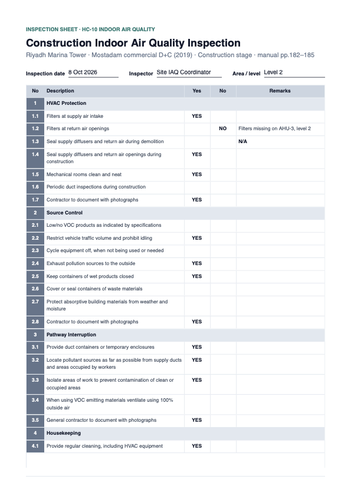
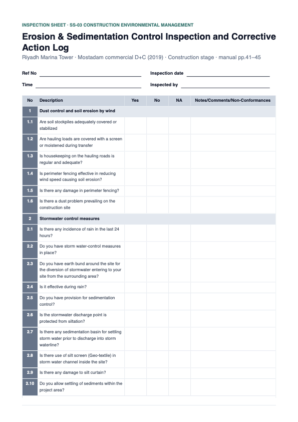

# 3 — Checklist forms in the database, AI-drafted and human-reviewed

**Type:** Feature · **Effort:** L · Supersedes the code-based template of [item 2](../02-iaq-inspection-sheet/task.md)

## As raised

Research for Hadi (2026-10-08) showed IAQ and ESC checklists are
**project-specific**: each comes out of a plan the contractor writes for that
project (an IAQ Management Plan following SMACNA; an ESC plan or CEMP for the
site). The rating system fixes the headings, not the items. Item 2 had put the
Jeddah contractor's items in code, shared by every project.

> Design a system that stores the template format — the list of questions per
> checklist — in the database against a project, and the download button
> generates the PDF on the fly. Seed the current IAQ checklist content.
>
> When you click the button it should show a preview of the responses filled
> by the AI. The admin can keep that response or override it, then download
> the resulting PDF.

Decisions (Hadi, 2026-10-08):

| Question | Answer |
|---|---|
| What does the AI suggest when the plan does not mention an item? | **Leave it blank.** It suggests Yes (with the plan's sentence) or N/A (only if the plan says so), never No: silence in a plan is not a failure on site |
| Does the PDF show which answers came from the AI? | **No, final answers only**, with "Responses reviewed by <name> on <date>"; AI vs override is kept in the database |
| Which photos go in an inspection's PDF? | **All photos on the credit** |
| Template editor? | **Included** |
| Browser checks | **No Playwright**: curl, database tests and downloaded PDFs |

## Design

| Table | Holds |
|---|---|
| `checklist_template` | One form. No `project_credit_id` = workspace default, matched to a credit by title; with one = a project's own copy. Title, confirmation text, and which required documents are the plan (read by the AI) and the completed sheet (gives the stage) |
| `checklist_section`, `checklist_item` | Headings and questions in order; an item is switched off, never deleted |
| `checklist_inspection` | One filled copy: date, inspector, area, the AI draft's state, who reviewed it and when |
| `checklist_response` | One per item: number, heading and text copied in at the start, the AI's suggestion and quote, the final answer, the remark |

Numbering (1.1, 1.2…) is computed from order. Copying the item text into each
response means editing the form later never rewrites a past inspection.

Flow: credit page → **Inspections** (list, *New inspection*, *Edit form*) →
*New inspection* copies the default into the project if needed, snapshots the
active items, and starts the AI draft in the background → the review page shows
each item's suggestion and quote, pre-selected, with Yes / No / N/A / blank and
a remark to keep or override → *Save* records the reviewer → *Download PDF*.

## Commits

| # | Commit |
|---|---|
| 1 | Schema and migration `0008` (five additive tables) |
| 2 | Seed migration `0009` (the IAQ default) and the data layer: default lookup, copy to project, start an inspection, save responses; database tests |
| 3 | AI draft per inspection, from the existing verified plan read |
| 4 | Inspections list and review page |
| 5 | PDF from a saved inspection; the code template, its route and button removed |
| 6 | Form editor |
| 7 | Done section, evidence |

---

## Done — 2026-10-08

The IAQ form now lives in the database, per project, and every download is a
reviewed inspection.

### How it works for the user

1. **Credit page → Inspections** (shown on any credit whose title has a form:
   HC-10 Indoor Air Quality today).
2. **New inspection.** The project gets its own copy of the standard form on
   first use. The active items are copied into the inspection, and the AI
   drafts answers in the background (about 15 s).
3. **Review page.** Each item shows the AI's suggestion and the plan sentence
   behind it, pre-selected. Keep or override with Yes / No / N/A / blank, add
   remarks, fill date, inspector and area, **Save review**. Saved answers are
   never overwritten by a later draft; **Re-run AI** is there for a plan
   uploaded later.
4. **Download PDF** (only after saving): the team's layout with the final
   answers, "Responses reviewed by <name> on <date>", a blank signature line,
   and the photos table. A draft cannot be downloaded (409).
5. **Edit form**: rename, reorder, add, switch items off, change the title and
   statement, for this project only. A project still on the standard form is
   asked to "Make this project's own copy" first.

### Commits

| Commit | Change |
|---|---|
| `0b522b6` | Tables and migration `0008` (additive) |
| `68ba654` | Seed migration `0009` (the IAQ default, generated from the item-2 template so the text is exact) and the data layer |
| `a6c0132` | AI draft: Yes or N/A with a verified quote, otherwise blank, never No |
| `b6eb9be` | Inspections list and review page |
| `068b95f` | PDF from a reviewed inspection; the code template, its route and button removed |
| `a21c084` | Form editor |
| this one | Done section, evidence |

### Evidence

[A reviewed inspection, downloaded from the app](./evidence/after-reviewed-inspection.pdf)

The Riyadh test project, with a test IAQ plan and a photo attached: the AI
suggested 23 of 32 answers (21 Yes; N/A on 1.3 "no demolition in this scope"
and 5.2 "no part of the building will be occupied"); the reviewer overrode
1.2 to No with a remark and answered 1.1 Yes. The PDF prints exactly those
answers.

### Checks (no Playwright, as asked)

The pages' real forms were submitted as no-JavaScript POSTs, which Next.js
server actions accept, so the field names and wiring are tested, not just the
functions underneath.

| Check | Result |
|---|---|
| Inspections link on HC-10's page, not on SS-03's; SS-03's inspections URL | present / absent / 404 |
| New inspection | 303 to the review page; 32 responses; project copy created |
| AI draft (live model) | done in about 15 s; 23 suggestions, each with a verbatim quote; no "No" |
| Save review | 303 `?saved=1`; overrides stored beside the AI's suggestions; reviewer and date recorded |
| PDF: no cookie / other project's inspection / unreviewed / reviewed | 401 / 404 / 409 / 200 |
| Old `/inspection-sheet` route | 404 |
| Editor on Jeddah: copy, switch off, add item, rename section | 303 each; standard form still 32/32 with its heading |
| Editing a row of the standard form through a project | refused (database test) |
| Editing a form after an inspection | the inspection keeps its wording (database test) |
| `pnpm test` / with database tests | 183 / 198 passing |
| `tsc`, lint, `pnpm build` | clean, 0 errors, succeeds |

All test inspections, project copies and test files were removed afterwards;
the dev database holds only the seeded standard form.

### Deploying

Both migrations run on `pnpm start` (it migrates first), so Railway gets the
tables and the IAQ form on the next deploy. The seed attaches to the solo
workspace `ws_default`.

### Adding the ESC form later

It is data now: one row in `checklist_template` with `credit_title`
"Construction Environmental Management", its sections and items, the plan
document ("CEMP developed") and the completed-sheet document ("Site audit
report"). A seed migration like `0009`, or the editor on a project. No code.

---

## Added — 2026-10-08: the ESC form

Hadi sent the contractor's ESC Inspection Checklist (MBL-JCD-ESC-001) and
asked for it to be seeded alongside IAQ so a fresh deploy has both.

**Seeded** (migration `0011`): the default form for any credit titled
"Construction Environmental Management" (SS-03). 28 items in four sections
(dust and wind erosion 6, stormwater 11, dewatering 4, housekeeping 7),
transcribed word for word, grammar included. The AI reads the plan attached
under "CEMP developed…"; the sheet is a construction-stage document
("Site audit report…").

**The form's layout differs from IAQ's, so layout is now per form**
(migration `0010`, additive; IAQ keeps its layout through the defaults):

| | IAQ | ESC |
|---|---|---|
| Columns | Yes · No · Remarks (N/A in Remarks) | Yes · No · **NA** · **Notes/Comments/Non-Conformances** |
| Header | Inspection date · Inspected by · Area | **Ref No** · Inspection date · **Time** · Inspected by |
| Sign-off | Confirmation statement, Signature, Date | **Checked & verified by**, Position, Signature: Sustainability Manager and Environmental Manager |

**"No is compliant" questions.** Five ESC questions are phrased so that
"Yes" is a problem: fence damage, a dust problem, silt-curtain damage, a
spill or leak, vehicle maintenance on site. Three have no compliant answer:
rain in the last 24 hours and the two "do you allow" questions. Each item now
records its compliant answer, and the AI only suggests Yes where Yes is
compliant. Without this, a CEMP line like "any spill shall be cleaned up
immediately" would have produced "Yes, there is a spill". The editor sets it
per item; the review page labels the No-compliant ones.

**Found in the live run and fixed:** the AI first suggested "Yes" for the
concrete washout item, quoting "Concrete washout is not permitted on site".
The prompt now treats "not permitted on site" as N/A; the re-run gave N/A.

[ESC sheet, downloaded from the app](./evidence/after-esc-reviewed-inspection.pdf):
a new inspection saved with the header left blank, so Ref No, date, time and
inspected by print as empty lines to fill by hand. None of these is ever
pre-filled: a new inspection starts with all four empty. (The first version of
this evidence carried values typed in from the client's sample during testing;
Hadi asked for it to show them empty, 2026-10-08.)

| Check | Result |
|---|---|
| Inspections link on SS-03 | present |
| AI draft on SS-03 with a test CEMP (live model) | 13 Yes, 2 N/A, 13 blank; **0 Yes on a No-compliant or observation item** |
| Review saved through the real form (Ref No, date, time, inspector, answers) | 303 `?saved=1`, all stored |
| A new inspection's header | empty in the database and on the review page; prints as blank lines |
| PDF | NA column, notes column, two sign-off blocks, no statement, header two per line |
| Fresh empty database, all 12 migrations | both forms seeded (IAQ 6/32, ESC 4/28) |
| Tests with database / tsc / lint / build | 202 passing / clean / 0 errors / succeeds |

**Not built:** the third page of the ESC form, the Environmental
Observations log (observation, recommendation, before and after photos,
corrective action, dates, status). That is a list of findings that each get
closed out, not a checklist, so it is its own feature. For now the ESC PDF
keeps the Description | Photos page.

**A deliberate difference:** the team's ESC form has no item numbers; the
app numbers items (1.1, 1.2…) so reviewers and the AI can refer to them.

---

## Added — 2026-10-08: the ESC corrective-action log

The third page of the client's ESC form is an **Environmental Observations**
log: Sr#, Observation, Recommendation, Photo, Corrective Action Taken, Photo,
Obs. Date / Closing Date, Status. Decisions (Hadi):

| Question | Answer |
|---|---|
| Where do observations come from? | **Automatically from non-compliant answers, plus added by hand** |
| Per inspection or running? | **A running log per credit**: open until someone closes it |
| AI help? | **The AI drafts the recommendation**, editable |
| Which forms? | **ESC only, switchable per form** (Edit form → form settings) |

How it works:

- **Saving a review** opens an observation for every non-compliant answer,
  meaning No on a "Yes is compliant" item or Yes on a "No is compliant" one,
  unless the log already has an open one for that item. N/A, blanks and
  observation-only items never open one.
- **The AI drafts a recommendation** from the observation and the project's
  CEMP, labelled "AI draft" until a person edits it. A late draft never
  overwrites a person's text.
- **On the Inspections page** each row is editable: observation,
  recommendation, before photo, corrective action, after photo (PNG or JPEG,
  stored as the credit's evidence), observed and closing dates, Open/Closed.
  Closing without a date records today.
- **In the PDF** the log replaces the plain photo list, on a landscape page in
  the client's columns and colours (dark green header, Environmental
  Observations band, Open amber, Closed green). It prints the log as it
  stands when downloaded.

[ESC sheet with the log, downloaded from the app](./evidence/after-esc-observations-log.pdf)
uses **placeholder images**: a damaged and a repaired fence, and an oil leak.

Live run (Riyadh test project, SS-03, test CEMP): three non-compliant answers
(stockpile uncovered, fence panels down, diesel leak) opened three
observations. The AI drafted recommendations in the CEMP's own terms, for
example "Repair the two damaged panels on the north side… within 48 hours, as
required by the CEMP"; the 48 hours is the plan's figure. Photos were uploaded
through the real row forms and the fence observation was closed.

**Found and fixed in the run:** three observations raised by one save share a
timestamp and were ordered by random id, so the Sr# order was unstable. They
now take the checklist's item order.

Checks: 210 tests passing with the database (log logic, de-duplication, closing,
recommendation ownership, landscape PDF), tsc clean, lint 0 errors, build
succeeds; a fresh database gets the ESC form with its log switched on. All
test data and files were removed afterwards.

---

## Added — 2026-10-11: photos during an inspection

> Can't manually upload photos while going to inspections. All photos added
> should show up as additional photos in the credit (apart from the
> before/after ones).

- The review page has a **Photos** section: upload one or more PNG/JPEG site
  photos while inspecting. They are stored as the credit's **additional
  attachments**, so they appear on the credit page and in its PDFs (the IAQ
  sheet's photo list, the compliance checklist). Thumbnails of the credit's
  additional photos show in the section. A wrong file type stores nothing and
  says so on the page.
- **Before / after photos** of the ESC observations log are no longer listed
  among the credit's additional attachments, and so no longer print in the
  compliance checklist's photo list; they stay with their observation.

Checked through the real forms on Jeddah: two photos uploaded from an HC-10
review appeared as thumbnails, under the credit's Additional attachments and in
the IAQ PDF (2 images); a .txt plus a .png stored nothing and showed the
message; on SS-03 a review-page photo is listed under Additional attachments
and an observation's before photo is not. 219 tests passing with the database.

**ESC photos (Hadi: yes, 2026-10-11):** the ESC sheet now prints the credit's
photos on their own page after the observations log — those uploaded during
inspections or against its documents, never the before / after photos, which
stay in the log. No photos, no page.
[ESC sheet: checklist, log, then photos](./evidence/after-esc-log-then-photos.pdf)
(placeholder images).
